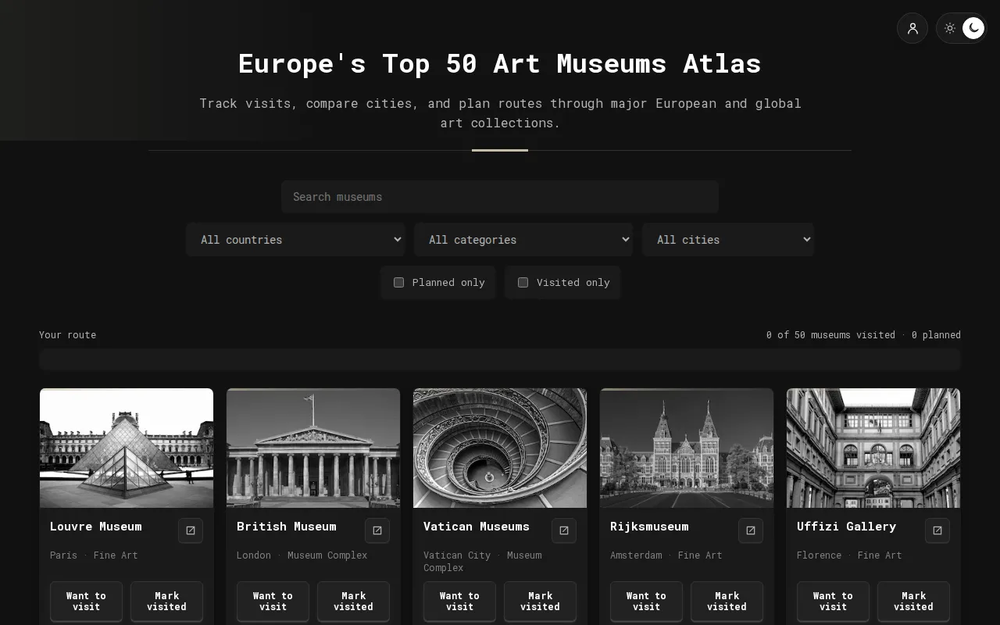
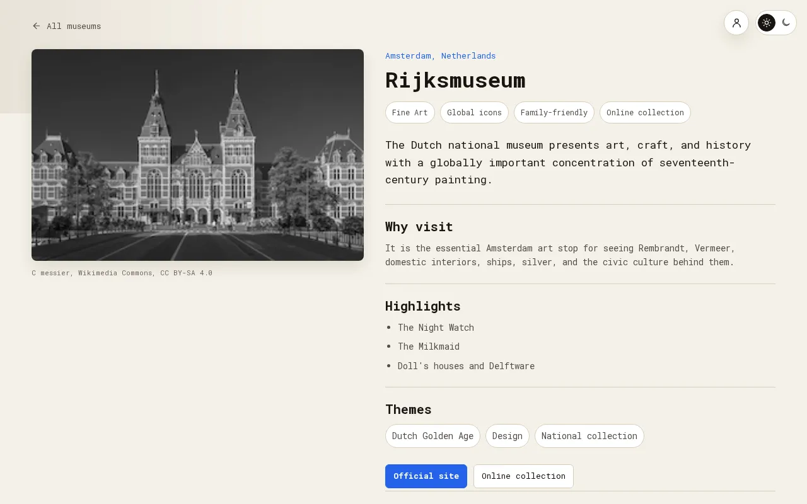
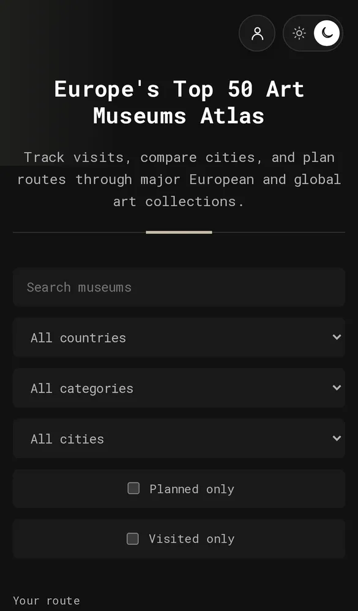

# 🎨 ArtMuse

**Steal culture legally.** Track, plan and collect Europe's top 50 art museums.

### [🎨 Open ArtMuse → artmuse.app](https://artmuse.app)

<picture>
  <source media="(prefers-color-scheme: dark)" srcset=".github/assets/desktop-dark.webp">
  <source media="(prefers-color-scheme: light)" srcset=".github/assets/desktop-light.webp">
  
</picture>

## ✨ What it does

| | |
|---|---|
| 🏛️ **50 must-see museums** | Hand-picked art museums, palaces and artist houses across 17 countries and 29 cities, from the Louvre to the Munch Museum. |
| 🔎 **Find your next one** | Search by name, artist or theme, and filter by country, city or category. |
| ⭐ **Plan it** | Tap *Want to visit* to build your shortlist. |
| ✅ **Collect it** | Tap *Mark visited* and watch your count climb: "12 of 50 museums visited". |
| 📖 **Know why you're going** | Every museum gets reasons to visit, highlights, its official site and its online collection. |
| 🌗 **Light or dark** | Gallery-dark by default, museum-paper light if you prefer. |
| 📱 **Pocket-sized** | Works on phone, tablet and desktop. |
| 🔒 **No account needed** | Your list lives in your browser. |

<table>
  <tr>
    <td align="center"> A museum page: why go, highlights, links</td>
    <td align="center"> On your phone</td>
  </tr>
</table>

## 🗺️ How to use it

1. **Browse** 👀 Open [artmuse.app](https://artmuse.app) and filter by the city you're heading to.
2. **Plan** ⭐ Mark the museums you want to see.
3. **Collect** ✅ Mark each one visited after you've been, and keep going until you hit 50.

## 🛣️ Roadmap

| Status | What |
|---|---|
| ✅ | 50-museum atlas with search and filters |
| ✅ | Want-to-visit and visited tracking with a progress count |
| ✅ | Museum pages with highlights, official links and online collections |
| ✅ | Light and dark themes, phone to desktop |
| ✅ | A new name and home: ArtMuse at [artmuse.app](https://artmuse.app) |
| ✅ | Email sign-in, so your list follows you across devices |
| ✅ | Saved trip routes for signed-in travellers |
| 🔮 | A scratch-off Europe map of your museum journey, ready to print or share |
| 🔮 | Collections and badges: Impressionist Hunter, Renaissance Master, Northern Masters |
| 🔮 | An AI museum guide that adapts to you: tourist, student or art nerd |

## 🙌 Credits

- 📷 **Museum photos** come from photographers on [Wikimedia Commons](https://commons.wikimedia.org), each under its own Creative Commons licence. Every image's author and licence is listed in [the image credits](docs/sources.md#image-methodology).
- 🏛️ **Museum facts** come from the museums themselves, for example the [Louvre](https://www.louvre.fr/en), [Prado](https://www.museodelprado.es/en), [Rijksmuseum](https://www.rijksmuseum.nl/en), [Uffizi](https://www.uffizi.it/en/the-uffizi) and [British Museum](https://www.britishmuseum.org/). Each museum page links its official site.
- 📊 **Visitor context** from [The Art Newspaper's most-visited museums survey](https://www.theartnewspaper.com/).
- Museum names and trademarks belong to their owners. ArtMuse is an independent project and is not affiliated with any museum.

---

🔧 Technical notes for the maintainer live in [docs/](docs/DEVELOPMENT.md).

© Aydar Gazizullin — all rights reserved. See [LICENSE](LICENSE).
